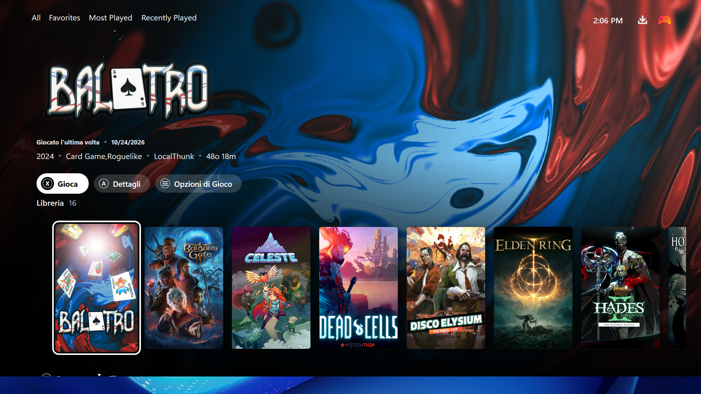
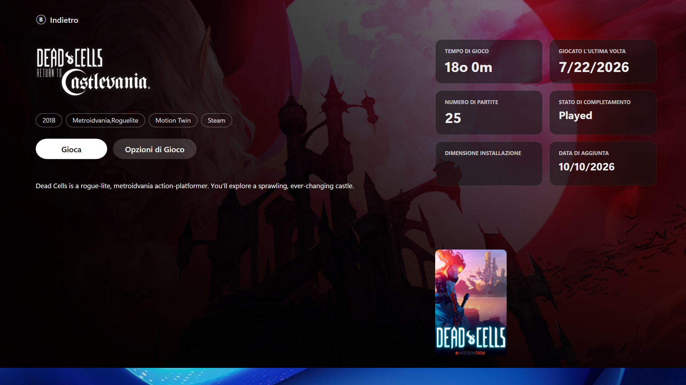
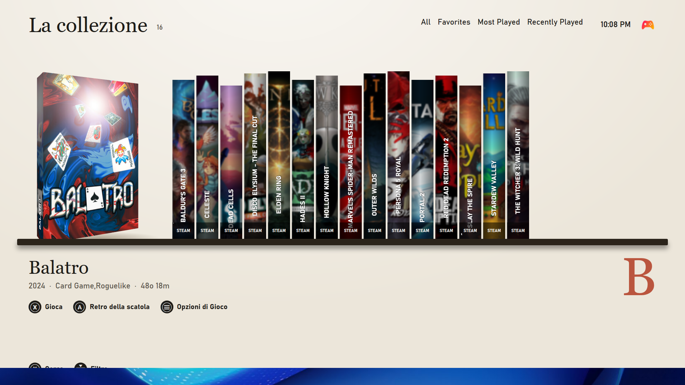
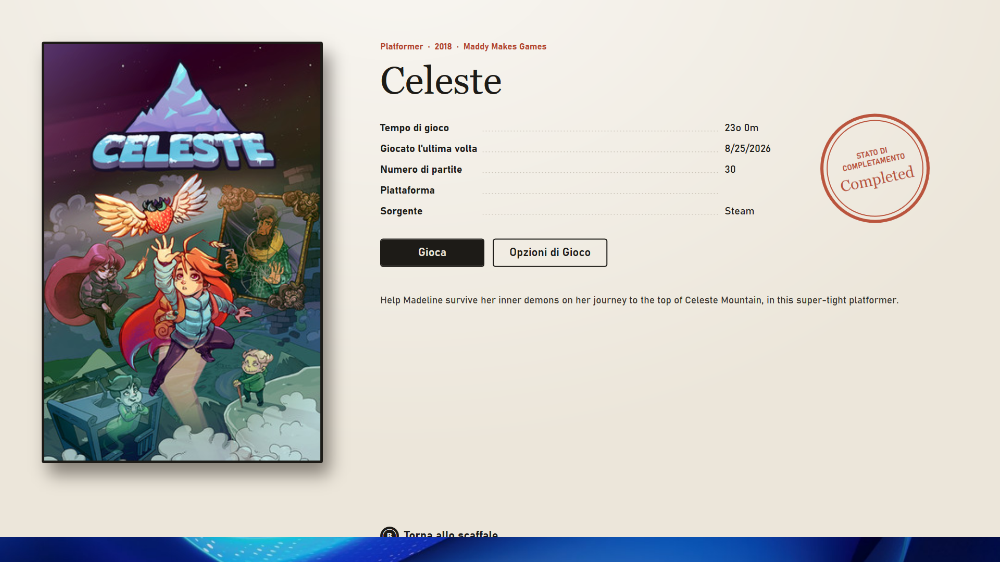
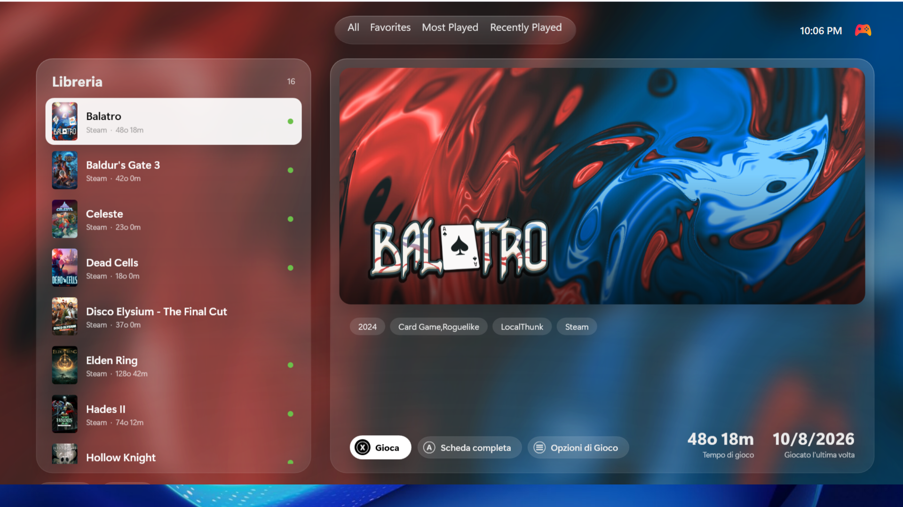
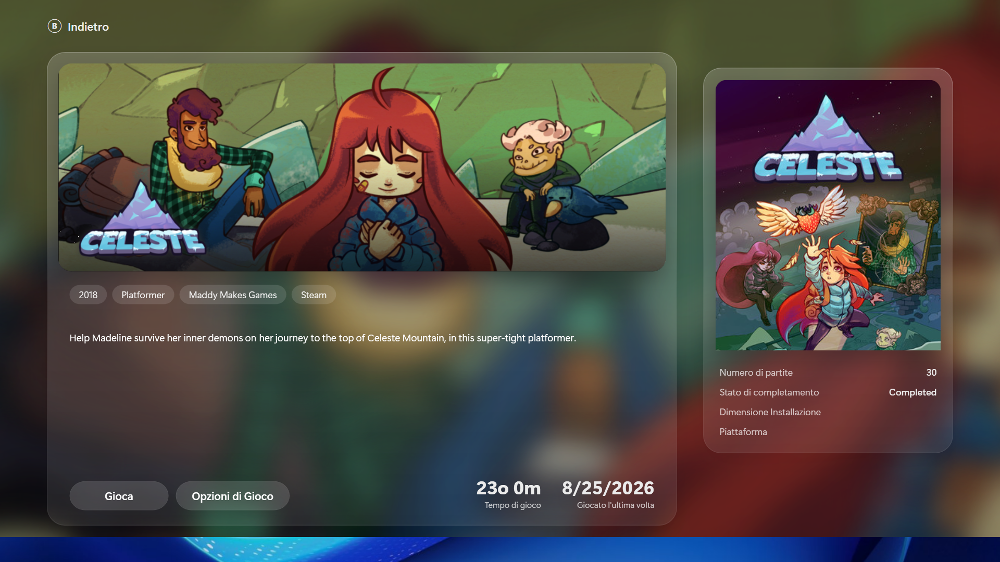
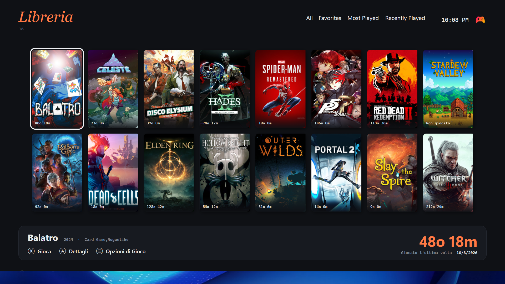
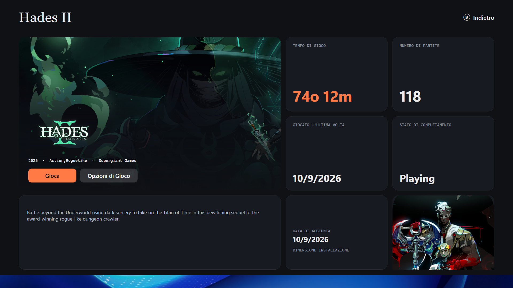

# Playnite Fullscreen themes

Four fullscreen themes for [Playnite](https://playnite.link), built for the couch: big type, controller-first, and nothing that spins or slides under you — only the focus moves.

| Theme | Library | Details |
|---|---|---|
| **Cinema** | The selected game's artwork fills the screen, its logo on the left, one row of covers below. | Artwork, logo, chips, description and stat cards. |
| **Shelf** | A shelf of spines on warm paper; the selected game is pulled out as a full box. | The back of the box: big cover, dotted-leader specs, a completion stamp. |
| **Glass** | Frosted panes over the blurred artwork: a still list on the left, a large preview on the right. | Two glass windows: game card and a side window with cover and facts. |
| **Journal** | A still grid of covers with time played, and a bar with the selected game's hours in large type. | A bento of tiles: artwork, time played, sessions, completion, cover, description. |

Design mocks for every theme are in [`mocks/`](mocks) — open the HTML files in a browser.

## Screenshots

Captured automatically in Playnite 10.62 after every change to `main` (*Screenshots (main)* workflow).

### Cinema

| Library | Details |
|---|---|
|  |  |

### Shelf

| Library | Details |
|---|---|
|  |  |

### Glass

| Library | Details |
|---|---|
|  |  |

### Journal

| Library | Details |
|---|---|
|  |  |

## Requirements

- Playnite 10.62 or later (fullscreen theme API 2.10).
- Recommended: [Extra Metadata Loader](https://github.com/darklinkpower/PlayniteExtensionsCollection) for game logos (Cinema, Glass, Journal). Without it the themes show the game title instead.
- Background images make Cinema and Glass shine: download them with your metadata source of choice.

### Suggested settings

- **Cinema**: *Settings → Layout*: Rows `1`, Horizontal layout on. The library is a single row at the bottom.
- **Journal**: *Settings → Layout*: Rows `2`, Horizontal layout on.
- **Shelf** and **Glass** draw their own library (a shelf and a list), so rows and columns don't apply to them.

## Languages

The themes reuse Playnite's own strings wherever possible, so they follow Playnite's language. The few strings of their own are translated in each theme's `Localization/` folder: English, Italian, German, French, Spanish and Brazilian Portuguese. To add a language, copy `en_US.xaml` to the Playnite language code (for example `pl_PL.xaml`) and translate the values.

## Repository layout

```
themes/<theme>/        theme sources (theme.yaml, XAML, Localization/, installer.yaml)
scripts/build.py       validate, package (.pthm), update installer manifests
scripts/ci/            Windows checks: load every XAML file with Playnite's assemblies, take screenshots
addon-db/              manifests for the Playnite add-on database
mocks/                 HTML design mocks
```

## Development

```bash
python3 scripts/build.py validate        # manifests, XML, file names Playnite loads, strings
python3 scripts/build.py build           # packages into dist/*.pthm
```

To try a theme, copy `themes/<theme>` into `%AppData%\Playnite\Themes\Fullscreen\` (or your portable install's `Themes\Fullscreen\`), restart Playnite and pick it in *Settings → Visuals*. You can also double-click a `.pthm` from `dist/` or from a CI run's artifacts.

Playnite only loads XAML files whose path matches a file of its built-in Default theme (plus `Localization/`). `build.py validate` fails on any other file name, because Playnite would silently ignore it.

## CI and releases

- **CI** (every push and PR): validates the themes, checks string keys against Playnite's, builds the four packages (downloadable as the `themes` artifact), and loads every XAML file with Playnite 10.62's assemblies on Windows.
- **Screenshots**: every PR that touches the themes runs each theme in a real Playnite fullscreen session on Windows (sample library, Extra Metadata Loader logos) and embeds library, details and menu in a comment on the PR. The images are stored under a hidden ref (`refs/screenshots/pr-<n>`), not a branch, and removed when the PR closes. After a merge, *Screenshots (main)* takes them again and commits only `docs/screenshots/`, shown above.
- **Release** (automatic, on every merge to `main`): every theme whose files changed since its last release gets its version bumped (patch by default; label the PR `release:minor` or `release:major` to go higher, `release:skip` to release nothing), a tag `<theme>-v<version>`, a GitHub release with the `.pthm`, and a new entry in `themes/<theme>/installer.yaml`, which Playnite reads to install and update the theme. The PR title becomes the changelog line. It can also be run by hand from *Actions → Release*.

## License

[MIT](LICENSE). Game artwork in the mocks belongs to its respective owners and is loaded from Steam's CDN for illustration only.
